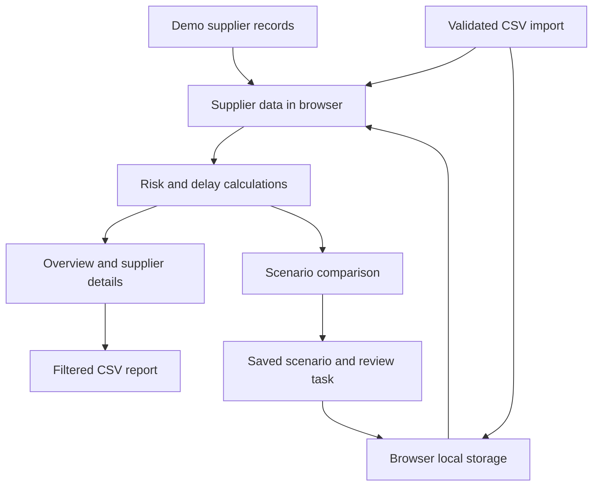

# How SupplyChainRisk works

This guide explains the application that is implemented in this repository. It starts with the user workflow, then follows the data and calculations behind it.

## 1. The problem it addresses

A procurement team needs to know which suppliers deserve attention. A supplier might deliver late, have quality problems, or account for such a large share of a category that replacing it would be difficult. Looking at those indicators separately makes comparison harder.

SupplyChainRisk brings them into one view. It calculates a comparable risk index, shows the inputs behind that number, and lets a user explore what might change under a disruption or mitigation plan.

The current version demonstrates this decision workflow with fictional data and fixed mathematical rules. It does not learn from historical records, call a trained model, or estimate the real probability of a disruption.

## 2. The main user workflow

1. **Start in Overview.** See how many suppliers are high risk and how much annual spend is associated with them.
2. **Inspect a supplier.** Select its row, a priority signal, or a map marker to open the detail drawer. Review the score contributions and underlying metrics.
3. **Check shipments.** Explore the fictional orders, their planned dates, and their demonstration delivery statuses.
4. **Test a scenario.** Choose a supplier in Scenario lab and change the assumptions. Compare the original and scenario calculations.
5. **Save a next step.** Saving a scenario also creates a review task in Action plan. You can add manual tasks and mark them complete.

For example, a user might identify Shenzhen Precision as high risk, see that delays and dependency are large contributors, test a delivery buffer and reduced dependency, and save that scenario for further review.

## 3. Where the data comes from

The built-in supplier data is a JavaScript array named `DEMO_SUPPLIERS` in [`../dist/model.js`](../dist/model.js). Each object represents a supplier and already contains summary metrics; this prototype does not calculate those metrics from raw purchase orders.

A representative record is:

```json
{
  "id": "SUP-001",
  "name": "Shenzhen Precision",
  "country": "China",
  "region": "Asia Pacific",
  "category": "Electronics",
  "spend": 2480000,
  "on_time_rate": 62,
  "avg_delay_days": 13,
  "defect_rate": 4.1,
  "dependency": 85,
  "volatility": 78
}
```

Here, `on_time_rate: 62` means 62%, `defect_rate: 4.1` means 4.1%, and `dependency: 85` means this supplier accounts for 85% of the relevant category's purchasing. `volatility` is an assumed 0–100 variability index. Its conversion from real lead-time history is not implemented.

CSV import is the second supplier-data source. It validates all rows before appending them to the directory, rejects duplicate IDs, and assigns imported records an `imported` flag. Those records use the same scoring formulas as the demo suppliers.

## 4. How the components connect



The HTML loads [`../dist/app.js`](../dist/app.js) as a JavaScript module. That module imports the calculation and data utilities from `model.js`, reads any saved local state, and renders the selected view. Navigation uses URL fragments such as `#suppliers` and `#scenarios`.

Click, input, change, and submit handlers update application state and render the relevant content. Moving a scenario slider recalculates the result immediately. The application has no framework, API server, or database layer.

## 5. Calculating the risk index

The metrics use different units: percentages, days, and an index. The prototype first puts them on comparable scales, then applies fixed weights.

Let:

- `O` = on-time delivery percentage.
- `H` = average historical delay in days.
- `Q` = defect percentage.
- `C` = category dependency percentage.
- `V` = lead-time variability index.

The normalized components are:

```text
delivery_component = clamp((100 - O) × 1.45, 0, 100)
delay_component    = clamp(H × 8.5, 0, 100)
quality_component  = clamp(Q × 18, 0, 100)
dependency         = C
volatility         = V
```

`clamp(value, 0, 100)` limits a value to that range. Imported dependency and volatility values are validated as 0–100 before scoring.

The final index is:

```text
risk_index = round(
    delivery_component × 0.40
  + delay_component    × 0.25
  + quality_component  × 0.15
  + dependency         × 0.12
  + volatility         × 0.08
)
```

The five weights sum to 1. A high value represents greater exposure under these assumptions. The rounded score determines the band: **0–34 low**, **35–64 medium**, and **65–100 high**.

### Worked example: Shenzhen Precision

| Factor | Calculation | Contribution |
| --- | --- | ---: |
| Delivery reliability | `(100 - 62) × 1.45 = 55.1`; then `× 0.40` | 22.04 |
| Historical delays | `13 × 8.5 = 110.5`, capped at `100`; then `× 0.25` | 25.00 |
| Quality issues | `4.1 × 18 = 73.8`; then `× 0.15` | 11.07 |
| Supplier dependency | `85 × 0.12` | 10.20 |
| Lead-time volatility | `78 × 0.08` | 6.24 |
| **Total before rounding** | | **74.55** |
| **Displayed index** | Rounded to the nearest integer | **75 — High risk** |

The drawer displays these weighted contributions so the user can see why the supplier has that score. A score of 75 does **not** mean a 75% chance of disruption. The coefficients and risk bands were chosen for the demonstration and were not fitted or calibrated on observed outcomes.

## 6. Estimating delay exposure

Delay exposure uses a separate formula and is displayed in days:

```text
delay_days = round_to_1_decimal(
    H × 0.8
  + (100 - O) × 0.045
  + V × 0.018
  + Q × 0.15
)
```

For Shenzhen Precision:

```text
(13 × 0.8) + (38 × 0.045) + (78 × 0.018) + (4.1 × 0.15)
= 10.4 + 1.71 + 1.404 + 0.615
= 14.129
→ 14.1 days
```

This estimate is a demonstration of how a delay output could appear in the product. It is not the output of a trained regression model. Annual spend and supplier dependency do not enter this delay formula.

## 7. Exploring a scenario

The scenario function copies a supplier record and adjusts four inputs. It then calls the same risk and delay functions on that copy.

| Control | Range | What the calculation changes |
| --- | --- | --- |
| Additional disruption | 0–14 days | Adds days to effective historical delay and adds 3 volatility points per disruption day. |
| Planning buffer | 0–14 days | Subtracts days from effective historical delay exposure, with a lower bound of zero. |
| On-time delivery improvement | 0–25 percentage points | Increases the assumed on-time rate, capped at 100%. |
| Reduce supplier dependency | 0–60 percentage points | Reduces dependency, with a lower bound of zero. |

In formula form:

```text
scenario_on_time_rate = clamp(O + reliability_improvement, 0, 100)
scenario_delay       = max(0, H + disruption_days - buffer_days)
scenario_dependency  = clamp(C - dependency_reduction, 0, 100)
scenario_volatility  = clamp(V + 3 × disruption_days, 0, 100)
```

The buffer represents reduced planning exposure. It does not demonstrate that the supplier physically delivers earlier or changes its historical performance. Costs, replacement capacity, implementation feasibility, and relationships among the inputs are outside this calculation.

### Example: the Mitigation plan preset

Select Shenzhen Precision, then **Mitigation plan**:

| Metric | Original | Scenario |
| --- | ---: | ---: |
| Additional disruption | 0 days | 0 days |
| Planning buffer | 0 days | 5 days |
| Assumed on-time rate | 62% | 72% |
| Effective delay input | 13 days | 8 days |
| Category dependency | 85% | 60% |
| Volatility index | 78 | 78 |
| **Risk index** | **75 — High** | **58 — Medium** |
| **Delay exposure** | **14.1 days** | **9.7 days** |

The 17-point index reduction is a change in the formula result. It is not evidence that an actual intervention reduces disruption probability by 17 percentage points.

One useful limitation to notice is saturation: the original 13-day delay input already produces the maximum historical-delay component. Adding 7 disruption days raises the risk index only from 75 to 76, while delay exposure rises to 20.1 days. The capped risk component cannot reflect further delay increases; the separate delay calculation still can.

Saving a scenario stores the input changes and before/after scores, and creates a task describing them. It does not update the original supplier record, change its shipments, or optimize a purchasing plan.

## 8. Building the overview metrics

The overview aggregates the built-in suppliers plus any imported suppliers.

| Metric | Calculation |
| --- | --- |
| Active suppliers | Number of supplier records in the directory. |
| High-risk suppliers | Count of suppliers with rounded risk index at least 65. |
| On-time delivery | `sum(on_time_rate × annual_spend) / sum(annual_spend)`. |
| Annual spend at risk | Sum of annual spend for high-risk suppliers. |

On the unmodified demo data, there are **12 suppliers**, **3 high-risk suppliers**, **$19.17 million total annual spend**, **$5.58 million annual spend at risk**, and **82.7% spend-weighted on-time delivery**.

Spend at risk is an exposure total. No probability or loss severity is applied to it. The 82.7% rate comes from the supplier input data and is not calculated as the share of demo shipments labeled On track.

## 9. What shipment tracking represents

`makeShipments()` creates three fictional orders for each of the 12 original suppliers, giving 36 orders in total. The application always uses the original supplier array for this generation, so importing suppliers does not create shipment history.

The demonstration rules assign:

- **Delayed** to the first order for a high-risk supplier.
- **At risk** to the first two orders for suppliers scoring at least 35, except where the Delayed rule already applies.
- **On track** to the remaining orders.

That produces **22 On track**, **11 At risk**, and **3 Delayed** orders. At-risk and delayed orders use the supplier's delay-exposure estimate; on-track orders have zero assigned delay. The detail view adds the estimated delay rounded up to whole days to the planned arrival date.

Road transport is assigned to suppliers in the Americas. For other regions, the third order uses Air and the first two use Ocean. Order values are derived from supplier annual spend. Dates are generated around the fixed October 20, 2026 snapshot.

These statuses and dates demonstrate the interface. They are not observed carrier updates or independently predicted shipment outcomes.

## 10. Signals, map, search, and reports

**Priority signals:** The application selects up to three highest-scoring suppliers with index at least 35 and shows their input metrics in predefined signal layouts. It does not detect new incidents from news or external feeds.

**Global map:** Original suppliers have latitude and longitude fields used to place SVG markers on simplified coastlines. Curves to the US hub illustrate relationships; they are not actual transport routes. Standard CSV imports do not include coordinates, so imported suppliers do not receive map markers.

**30-day trend:** The displayed changes are fixed illustrative values in the demo supplier records. The application has no stored 30-day observation series from which to calculate them.

**Search and filters:** Supplier search matches names, countries, categories, and IDs. Shipment filtering combines search with status and transport mode. Global search finds suppliers and matches shipment IDs.

**Reports:** CSV exports include matching records under the active filters. Text is quoted and escaped; leading spreadsheet-formula characters are prefixed to reduce formula-execution risk when opened in spreadsheet software. Report exports do not contain the full saved task or scenario state.

## 11. Persistence and application state

Saved state lives in browser local storage under `supplychainrisk-v1`:

| Saved | Not saved as persistent application state |
| --- | --- |
| Watchlist supplier IDs | Current supplier and shipment filters or search text |
| Imported supplier records | Unsubmitted CSV selections |
| Tasks and completion status | Unsaved scenario slider values |
| Saved scenario assumptions and results | A shared server-side workspace or audit log |

The current page is represented by the URL fragment. On load, the app combines the built-in supplier array with saved imports and restores tasks, saved scenarios, and the watchlist. If browser storage is unavailable, it continues with session state and shows a notice.

Changes belong to the browser and site origin where they were made. A different device, browser profile, or localhost address will have different local data. Restoring the demo resets these local records after confirmation.

## 12. Verification and the path to a predictive system

The existing seven checks exercise risk bounds and thresholds, scenario invariants, portfolio and shipment consistency, CSV parsing and validation, export handling, and basic rendering of the five application views. The rendering check uses a small simulated DOM, so it does not establish that layouts and interactions have passed browser testing. No predictive-performance results are produced by these checks.

A future ML implementation would need work beyond this interface:

1. **Collect timestamped historical data.** Join suppliers, purchase orders, promised dates, actual receipt dates, order values, and quality events using stable supplier and order IDs.
2. **Define the prediction task.** Decide whether to predict an individual shipment delay, supplier risk over a future period, or both. Define the forecast horizon, late-delivery threshold, and evaluation unit before training.
3. **Build features using only past information.** Pandas and SQL could calculate rolling on-time rates, prior delay averages, order frequency, volume, and quality metrics. Future receipt dates or outcomes must not enter prediction-time features.
4. **Train and evaluate candidate models.** Compare a classification baseline such as logistic regression with XGBoost for a defined binary risk target. Evaluate delay regression separately. Use chronological holdouts and report precision, recall, F1, and MAE only when supported by actual held-out results.
5. **Connect predictions to the app.** Replace or supplement the heuristic outputs with a service returning the supplier ID, prediction timestamp, forecast horizon, risk output, estimated delay, model version, and explanations. Risk bands would need to be calibrated for the new outputs.
6. **Add durable shared operations.** Use a backend database for supplier history, predictions, tasks, and audit trails. Power BI could consume reporting tables. Integrate carrier feeds and business workflows only when their data and permissions are available.

Even a trained predictive model would not by itself establish that a slider change causes a particular outcome. A future scenario tool would still need explicit planning assumptions or a validated intervention model.

The current prototype gives that future system an explorable interface and a transparent reference calculation. The historical data pipeline, trained models, backend services, and measured business outcomes remain separate implementation steps.

Return to the [README](../README.md) for setup commands, the CSV schema, and the file guide.
